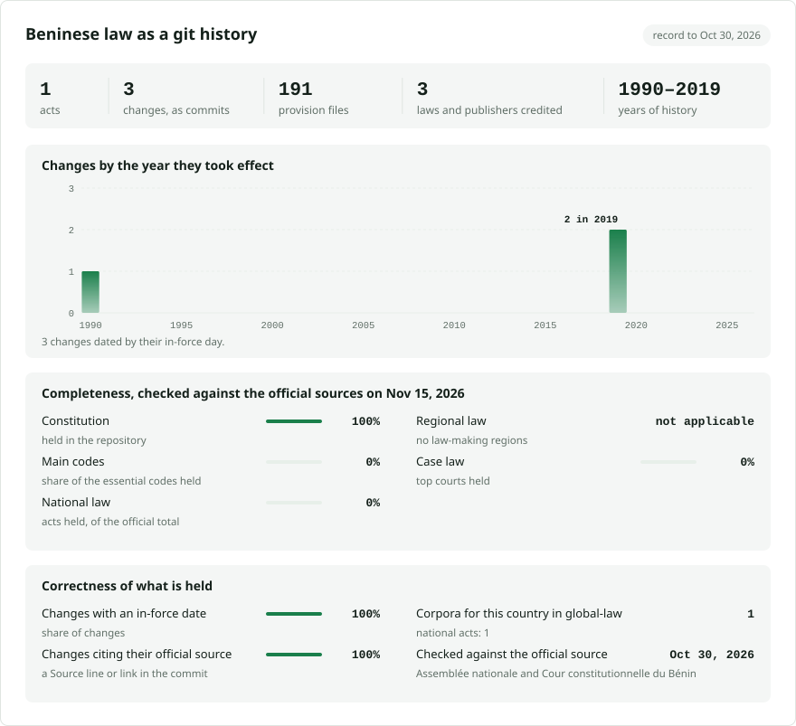

# Benin: law history in git

[Français](README.md) · **English**

<picture>
<source media="(prefers-color-scheme: dark)" srcset="data/effort-dark.svg">

</picture>

The law of Benin as a git history: one file per provision, each version committed on the day it took effect, and the law that made each change as the commit's author. `git blame` names the law behind every line; `git log` lists every change to an article; picking a date gives the text in force that day.

Part of [lexifina/global-law](https://github.com/lexifina/global-law), one git history for every country's law: this is Benin's national law, which global-law reads at `benin/national/acts/`.

**What is in it now:** the Constitution of 11 December 1990 (Loi n° 90-32), in two versions: as enacted, and as revised by Loi n° 2019-40 of 7 November 2019, with its 176 articles (18 of them added in 2019, such as 54-1), the preamble and the 13 title headings. No statute yet. [`constitution/README.md`](constitution/README.md) lists every provision.

Each provision is one file in `constitution/` (`art-042.md` is Article 42, the President's term of office; `art-054-01.md` is Article 54-1); the preamble is `preambule.md`, and each title heading has its own file (`titre-01.md`).

The text is in French, the official language of Benin, as the two publishers print it. An English translation is not part of this record.

## Questions as git commands

| Question | Command |
| --- | --- |
| Every change to Article 42 of the Constitution (the President's term) | `git log -p --word-diff -- constitution/art-042.md` |
| Which law wrote each line of Article 42? | `git blame constitution/art-042.md` |
| Every version of Article 42, with the day each took effect | `git log --format="%h %(trailers:key=In-force,valueonly,separator=) %an" -- constitution/art-042.md` |
| Article 42 as in force on 1 January 2015 | `python tools/on.py 2015-01-01 constitution art-042` |

**Outside git**, we also host this record publicly, for free:

- **[Ask Claude about Beninese law](https://global-law.lexifina.com/v1/try_claude?country=benin)**: opens Claude with a first question ready.
- **[Ask ChatGPT](https://global-law.lexifina.com/v1/try_chatgpt?country=benin)**: the same question in ChatGPT.
- **[Search Beninese law on our site](https://lexifina.com/law?country=benin&q=droit+de+gr%C3%A8ve)**: a search for "droit de grève" (the right to strike), with each provision's text and its versions, no account needed.
- **[Developer REST API](https://global-law.lexifina.com/v1/search_law?query=droit+de+gr%C3%A8ve&jurisdiction=benin)**: the same search as JSON, with no key. See the [documentation here](https://lexifina.com/api/global-law).

Both assistants read the record through the free Global law connector (MCP, `https://global-law.lexifina.com/mcp`); the first time, the chat gives you the link that adds it. Ask in French or in English.

**Host it yourself easily.** All it takes is git and Python, and the tools run on your machine:

```sh
git clone --depth 1 https://github.com/lexifina/global-law && cd global-law
python3 tools/countries.py add benin/national/acts
python3 tools/law.py show 2026-01-01 benin/national/acts/constitution/art-042.md
```

Opened in Claude Code, Cursor, VS Code or Codex, the clone also starts a local MCP server with the same tools ([MCP.md](https://github.com/lexifina/global-law/blob/main/MCP.md)).

## Dates

Each commit is dated at noon, Africa/Porto-Novo, on the day the version took effect, and carries it in its `In-force:` trailer:

- 1990: the promulgation of Loi n° 90-32, 11 December 1990; the text sets no other commencement date;
- 2019: the promulgation of Loi n° 2019-40, 7 November 2019, whose article 2 brings it into force on promulgation.

The first version is credited to Loi n° 90-32. Provisions the Cour constitutionnelle marks "(nouveau)", and the repeal of articles 46 and 47, are credited to Loi n° 2019-40; the other 117 provisions that differ between the two copies are committed as unexplained changes, credited to the publishers. The committer is always Lexifina.

## How it is checked

- `tools/check_repo.py` reads every version back from git on the day it took effect and on the day before, and both must match the corpus the history was built from; it also checks that every commit's trailers parse, that there are no merge commits and that no commit is dated in the future.
- `tools/build.py` writes the history from that corpus in one pass, and the same corpus always gives the same commit hashes. The corpus itself is not in the repository; [`data/corpus.sha256`](data/corpus.sha256) gives its hash and [`data/versions.json`](data/versions.json) the hash of each source PDF.
- [`REPRODUCE.md`](REPRODUCE.md), written at the build on 2026-10-30, records the checks as not yet run for that build and no second build compared.

## What it does not show

- **The Constitution in force today.** Loi n° 2025-20 of 17 December 2025 revised it again; that text is published only as a scan with no text layer, so this history stops at the 2019 revision.
- **An exact 1990 text.** The first version is the Assemblée nationale's retyped copy, with its slips (a heading left at the end of Article 130, Article 138 inside `art-137.md`); most of the 117 unexplained changes are differences between that copy and the Court's text, not amendments.
- **Any statute.** The copies of the Code du numérique and the Code pénal that were found have unusable text layers.

## Sources

| Source | Kind | Past versions | Notes |
| --- | --- | --- | --- |
| Assemblée nationale du Bénin ([its PDF, Internet Archive capture of 2020-12-04](https://web.archive.org/web/20201204234550/https://assemblee-nationale.bj/wp-content/uploads/2017/10/Benin-La-Constitution-1990.pdf)) | The Constitution as promulgated in 1990, a retyped copy | no, the 1990 text only | The first version |
| [Cour constitutionnelle du Bénin](https://courconstitutionnelle.bj/fr/docs/textes-fondamentaux) | The Constitution consolidated to the revision of Loi n° 2019-40 | no, the 2019 text only | The second version; its "(nouveau)" marks give the credits to Loi n° 2019-40 |

## Licence

See [`LICENSE`](LICENSE). The texts are the official constitutional text of the Republic of Benin, published openly by the Assemblée nationale and the Cour constitutionnelle; a constitution is a public act of the State, neither site states a reuse restriction, and the publishers are credited as the source. The history, commit messages, tables and tools are CC0 1.0.

No AI model wrote, translated or corrected legal text, and none runs when the history is built; the scripts were written by an AI model (see [`REPRODUCE.md`](REPRODUCE.md)).

## More

From [lexifina/global-law](https://github.com/lexifina/global-law):

- [FEATURES.md](https://github.com/lexifina/global-law/blob/main/FEATURES.md): every feature, and what every corpus must support (`git blame`, `law.py`, the MCP tools)
- [FAQ.md](https://github.com/lexifina/global-law/blob/main/FAQ.md): questions and answers · [CONTRIBUTING.md](https://github.com/lexifina/global-law/blob/main/CONTRIBUTING.md): proposing changes · [MCP.md](https://github.com/lexifina/global-law/blob/main/MCP.md): the MCP server · [REPRODUCE.md](https://github.com/lexifina/global-law/blob/main/REPRODUCE.md): how it was built · [CHANGELOG.md](https://github.com/lexifina/global-law/blob/main/CHANGELOG.md)
- [FRESHNESS.md](https://github.com/lexifina/global-law/blob/main/FRESHNESS.md): how current each corpus is · [Monitoring](https://github.com/lexifina/global-law/tree/main/monitoring): whether updates are running · [WATCHING.md](https://github.com/lexifina/global-law/blob/main/WATCHING.md): how each official source is watched for changes
- [performance/](https://github.com/lexifina/global-law/tree/main/performance): how fast the tools are, measured
- [visualisations/](https://github.com/lexifina/global-law/tree/main/visualisations): charts and bridges across the world's law
- [Vulnerabilities](https://github.com/lexifina/global-law/tree/main/vulnerabilities): mistakes in legislation as published
