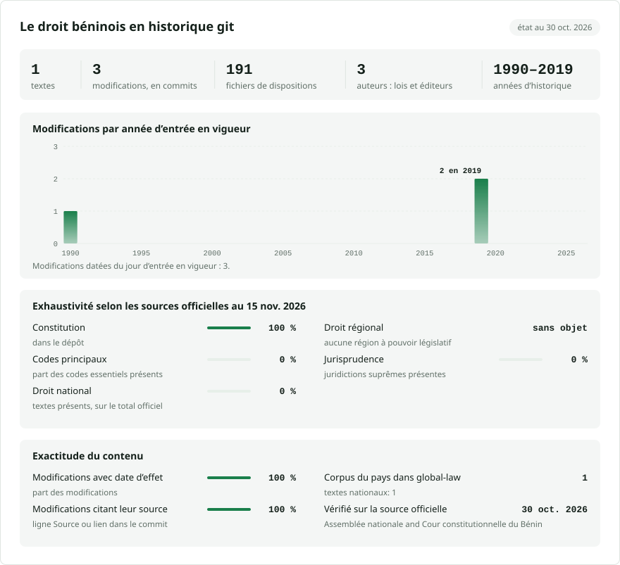

# Bénin : l’historique du droit dans git

**Français** · [English](README.en.md)

<picture>
<source media="(prefers-color-scheme: dark)" srcset="data/fr/effort-dark.svg">

</picture>

Le droit béninois sous forme d’historique git : un fichier par disposition, chaque version enregistrée au jour de son entrée en vigueur, et pour auteur de chaque commit la loi qui a apporté la modification. `git blame` désigne la loi à l’origine de chaque ligne ; `git log` énumère toutes les modifications d’un article ; le choix d’une date donne le texte en vigueur ce jour-là.

Fait partie de [lexifina/global-law](https://github.com/lexifina/global-law), un historique git unique pour le droit de chaque pays : ce dépôt contient le droit national béninois, que global-law lit dans `benin/national/acts/`.

**Contenu actuel :** la Constitution du 11 décembre 1990 (loi n° 90-32), en deux versions : telle que promulguée, et telle que révisée par la loi n° 2019-40 du 7 novembre 2019, avec ses 176 articles (dont 18 ajoutés en 2019, tel l’article 54-1), le préambule et les intitulés de ses 13 titres. Aucune loi pour l’instant. [`constitution/README.md`](constitution/README.md) énumère chaque disposition.

Chaque disposition est un fichier dans `constitution/` (`art-042.md` est l’article 42, relatif à la durée du mandat du Président de la République ; `art-054-01.md` est l’article 54-1) ; le préambule est `preambule.md`, et chaque intitulé de titre a son propre fichier (`titre-01.md`).

Le texte est en français, langue officielle du Bénin, tel que l’impriment les deux éditeurs. Une traduction anglaise ne fait pas partie de ce registre.

## Questions sous forme de commandes git

| Question | Commande |
| --- | --- |
| Toutes les modifications de l’article 42 de la Constitution (le mandat du Président) | `git log -p --word-diff -- constitution/art-042.md` |
| Quelle loi a écrit chaque ligne de l’article 42 ? | `git blame constitution/art-042.md` |
| Toutes les versions de l’article 42, avec le jour d’entrée en vigueur de chacune | `git log --format="%h %(trailers:key=In-force,valueonly,separator=) %an" -- constitution/art-042.md` |
| L’article 42 tel qu’en vigueur le 1er janvier 2015 | `python tools/on.py 2015-01-01 constitution art-042` |

**En dehors de git**, nous hébergeons aussi ce registre publiquement, gratuitement :

- **[Interroger Claude sur le droit béninois](https://global-law.lexifina.com/v1/try_claude?country=benin)** : ouvre Claude avec une première question prête.
- **[Interroger ChatGPT](https://global-law.lexifina.com/v1/try_chatgpt?country=benin)** : la même question dans ChatGPT.
- **[Rechercher dans le droit béninois sur notre site](https://lexifina.com/law?country=benin&q=droit+de+gr%C3%A8ve)** : une recherche de « droit de grève », avec le texte de chaque disposition et ses versions, sans compte.
- **[API REST pour les développeurs](https://global-law.lexifina.com/v1/search_law?query=droit+de+gr%C3%A8ve&jurisdiction=benin)** : la même recherche en JSON, sans clé. Voir la [documentation ici](https://lexifina.com/api/global-law).

Les deux assistants lisent le registre au moyen du connecteur gratuit Global law (MCP, `https://global-law.lexifina.com/mcp`) ; la première fois, la conversation vous donne le lien qui l’ajoute. Posez vos questions en français ou en anglais.

**L’héberger vous-même, simplement.** Il suffit de git et de Python, et les outils s’exécutent sur votre machine :

```sh
git clone --depth 1 https://github.com/lexifina/global-law && cd global-law
python3 tools/countries.py add benin/national/acts
python3 tools/law.py show 2026-01-01 benin/national/acts/constitution/art-042.md
```

Ouvert dans Claude Code, Cursor, VS Code ou Codex, le clone lance aussi un serveur MCP local doté des mêmes outils ([MCP.md](https://github.com/lexifina/global-law/blob/main/MCP.md)).

## Dates

Chaque commit est daté à midi, heure de Porto-Novo (Africa/Porto-Novo), du jour où la version est entrée en vigueur, et porte ce jour dans son trailer `In-force:` :

- 1990 : la promulgation de la loi n° 90-32, le 11 décembre 1990 ; le texte ne fixe aucune autre date d’entrée en vigueur ;
- 2019 : la promulgation de la loi n° 2019-40, le 7 novembre 2019, dont l’article 2 prévoit l’entrée en vigueur dès la promulgation.

La première version est attribuée à la loi n° 90-32. Les dispositions que la Cour constitutionnelle marque « (nouveau) », ainsi que l’abrogation des articles 46 et 47, sont attribuées à la loi n° 2019-40 ; les 117 autres dispositions qui diffèrent entre les deux exemplaires sont enregistrées comme des modifications inexpliquées, attribuées aux éditeurs. Le committer est toujours Lexifina.

## Comment il est vérifié

- `tools/check_repo.py` relit chaque version depuis git au jour de son entrée en vigueur et la veille, et les deux doivent correspondre au corpus à partir duquel l’historique a été construit ; il vérifie aussi que les trailers de chaque commit se lisent sans erreur, qu’il n’existe aucun commit de fusion et qu’aucun commit n’est daté dans le futur.
- `tools/build.py` écrit l’historique à partir de ce corpus en une seule passe, et le même corpus donne toujours les mêmes empreintes de commit. Le corpus lui-même ne figure pas dans le dépôt ; [`data/corpus.sha256`](data/corpus.sha256) en donne l’empreinte et [`data/versions.json`](data/versions.json) celle de chaque PDF source.
- [`REPRODUCE.md`](REPRODUCE.md), rédigé lors de la construction du 30 octobre 2026, indique que les vérifications n’avaient pas encore été exécutées pour cette construction et qu’aucune seconde construction n’a été comparée.

## Ce qu’il ne montre pas

- **La Constitution en vigueur aujourd’hui.** La loi n° 2025-20 du 17 décembre 2025 l’a de nouveau révisée ; ce texte n’est publié que sous forme de numérisation sans couche texte, de sorte que cet historique s’arrête à la révision de 2019.
- **Un texte exact de 1990.** La première version est l’exemplaire ressaisi de l’Assemblée nationale, avec ses erreurs (un intitulé laissé à la fin de l’article 130, l’article 138 à l’intérieur de `art-137.md`) ; la plupart des 117 modifications inexpliquées sont des différences entre cet exemplaire et le texte de la Cour, et non des révisions.
- **Aucune loi.** Les exemplaires du Code du numérique et du Code pénal qui ont été trouvés ont des couches texte inexploitables.

## Sources

| Source | Nature | Versions antérieures | Remarques |
| --- | --- | --- | --- |
| Assemblée nationale du Bénin ([son PDF, capture de l’Internet Archive du 4 décembre 2020](https://web.archive.org/web/20201204234550/https://assemblee-nationale.bj/wp-content/uploads/2017/10/Benin-La-Constitution-1990.pdf)) | La Constitution telle que promulguée en 1990, exemplaire ressaisi | non, le seul texte de 1990 | La première version |
| [Cour constitutionnelle du Bénin](https://courconstitutionnelle.bj/fr/docs/textes-fondamentaux) | La Constitution consolidée jusqu’à la révision opérée par la loi n° 2019-40 | non, le seul texte de 2019 | La seconde version ; ses mentions « (nouveau) » fondent les attributions à la loi n° 2019-40 |

## Licence

Voir [`LICENSE`](LICENSE). Les textes sont le texte constitutionnel officiel de la République du Bénin, publié librement par l’Assemblée nationale et la Cour constitutionnelle ; une constitution est un acte public de l’État, aucun des deux sites n’énonce de restriction à la réutilisation, et les éditeurs sont cités comme source. L’historique, les messages de commit, les tableaux et les outils sont sous CC0 1.0.

Aucun modèle d’IA n’a écrit, traduit ou corrigé de texte juridique, et aucun n’est exécuté lors de la construction de l’historique ; les scripts ont été écrits par un modèle d’IA (voir [`REPRODUCE.md`](REPRODUCE.md)).

Ceci est une traduction de la version anglaise ([README.en.md](README.en.md)) ; en cas de divergence, la version anglaise fait foi.

## En savoir plus

Dans le dépôt [lexifina/global-law](https://github.com/lexifina/global-law) (pages en anglais) :

- [FEATURES.md](https://github.com/lexifina/global-law/blob/main/FEATURES.md): toutes les fonctionnalités et ce que chaque corpus doit prendre en charge (`git blame`, `law.py`, outils MCP)
- [FAQ.md](https://github.com/lexifina/global-law/blob/main/FAQ.md): questions et réponses · [CONTRIBUTING.md](https://github.com/lexifina/global-law/blob/main/CONTRIBUTING.md): proposer une modification · [MCP.md](https://github.com/lexifina/global-law/blob/main/MCP.md): serveur MCP · [REPRODUCE.md](https://github.com/lexifina/global-law/blob/main/REPRODUCE.md): comment il a été construit · [CHANGELOG.md](https://github.com/lexifina/global-law/blob/main/CHANGELOG.md)
- [FRESHNESS.md](https://github.com/lexifina/global-law/blob/main/FRESHNESS.md): à quel point chaque corpus est à jour · [Surveillance](https://github.com/lexifina/global-law/tree/main/monitoring): si les mises à jour fonctionnent · [WATCHING.md](https://github.com/lexifina/global-law/blob/main/WATCHING.md): comment chaque source officielle est surveillée pour repérer les modifications
- [performance/](https://github.com/lexifina/global-law/tree/main/performance): la rapidité des outils, mesurée
- [visualisations/](https://github.com/lexifina/global-law/tree/main/visualisations): graphiques et liens à travers le droit du monde entier
- [Vulnérabilités](https://github.com/lexifina/global-law/tree/main/vulnerabilities): erreurs dans les textes tels qu’ils ont été publiés
